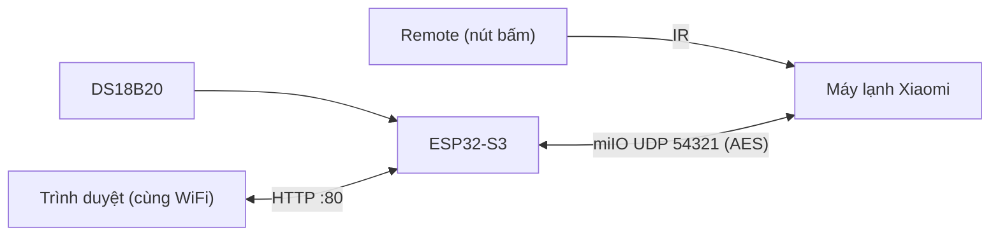
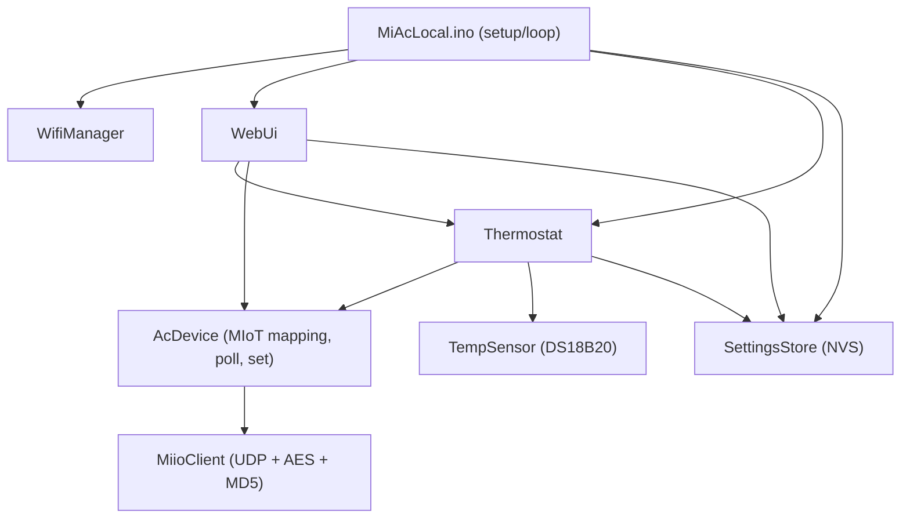
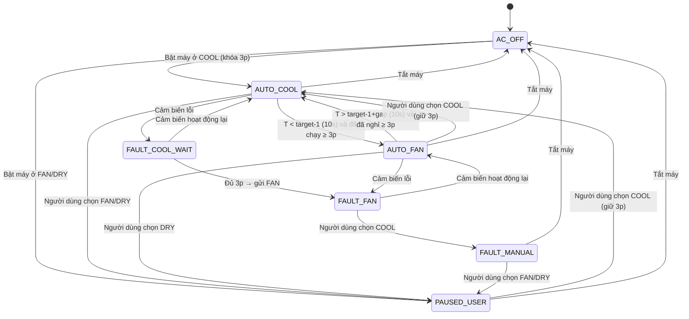
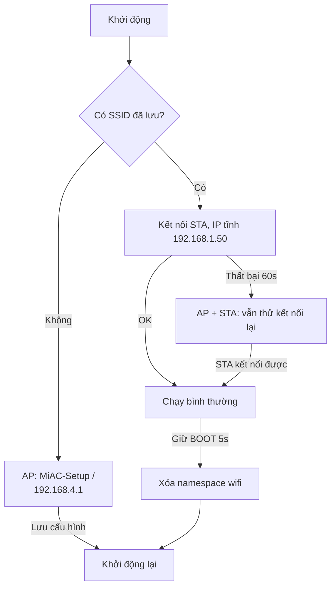

# MiAcLocal – Thiết kế chi tiết

Bộ điều khiển ESP32 cho máy lạnh **Xiaomi New Widetech Pro**, giao tiếp **local qua miIO (UDP 54321)**, không đi qua cloud.
ESP32 dùng cảm biến **DS18B20** của riêng nó để quyết định đóng/ngắt block bằng cách chuyển **COOL ↔ FAN** (cảm biến trên máy lạnh hoạt động sai nên máy luôn chạy block).

> [!IMPORTANT]
> Dự án nằm hoàn toàn trong thư mục `MiAcLocal/`. File `sketch_sep6a.ino` hiện tại **không bị chỉnh sửa**.

---

## 1. Phạm vi

| Có | Không |
|---|---|
| Điều khiển local miIO, mã hóa AES | Cloud Xiaomi / Mi Home |
| Thermostat COOL ↔ FAN theo DS18B20 | IR (tạm thời không dùng) |
| Bảo vệ block (min run / min rest / lock khi khởi động) | Mật khẩu web, mDNS, OTA |
| Đồng bộ 2 chiều remote ↔ ESP32 ↔ web | Lưu lịch sử nhiệt độ / biểu đồ |
| Web cấu hình + điều khiển + debug | |
| AP cấu hình lần đầu, IP tĩnh | |

---

## 2. Phần cứng

Giống sketch hiện tại:

| Thành phần | Chân | Ghi chú |
|---|---|---|
| ESP32-S3 | – | Board giống `sketch_sep6a.ino` |
| DS18B20 (DQ) | GPIO21 | Trở kéo lên 4.7 kΩ |
| Nút BOOT | GPIO0 | Giữ 5 s → xóa cấu hình WiFi |

Cảm biến đã được đặt ở vị trí đo đúng nhiệt độ phòng (người dùng xác nhận).

---

## 3. Kiến trúc tổng thể





**Nguyên tắc:** toàn bộ vòng lặp **không chặn** (non-blocking). Request miIO là state machine: gửi → chờ phản hồi trong `loop()` → timeout/retry, để web server luôn phản hồi.

---

## 4. Giao thức miIO

### 4.1 Gói tin

Header 32 byte (big-endian):

| Offset | Size | Trường | Giá trị |
|---|---|---|---|
| 0 | 2 | Magic | `0x2131` |
| 2 | 2 | Length | Tổng độ dài gói (header + payload) |
| 4 | 4 | Unknown | `0x00000000` (hello: `0xFFFFFFFF`) |
| 8 | 4 | Device ID | Lấy từ phản hồi hello |
| 12 | 4 | Stamp | Stamp thiết bị + số giây trôi qua từ lúc hello |
| 16 | 16 | Checksum | `MD5(header với 16 byte token ở vị trí checksum + payload)` |

- **Hello:** 32 byte, `21 31 00 20` + 28 byte `0xFF`. Phản hồi trả về Device ID và Stamp.
- **Mã hóa payload:** AES-128-CBC, padding PKCS#7
  - `key = MD5(token)`
  - `iv  = MD5(key + token)`
- **Thư viện:** `MD5Builder` (core Arduino) + `mbedtls/aes.h`. Cả hai đều có trên core ESP32 2.x và 3.x.

### 4.2 Lệnh JSON

```json
{"id":1001,"method":"get_properties","params":[{"did":"power","siid":2,"piid":1}, ...]}
{"id":1002,"method":"set_properties","params":[{"did":"mode","siid":2,"piid":2,"value":0}]}
{"id":1003,"method":"miIO.info","params":[]}
```

- `id` tăng dần. Khởi tạo bằng số ngẫu nhiên lúc boot, và nhảy +100 sau khi hello lại, để tránh thiết bị từ chối id trùng.
- Kết quả hợp lệ khi `code == 0` cho từng thuộc tính.

### 4.3 Quản lý kết nối

| Tham số | Giá trị |
|---|---|
| Chu kỳ poll | 3 s (1 lệnh `get_properties` đọc cả 7 thuộc tính) |
| Timeout mỗi request | 1.5 s |
| Retry | 2 lần, sau timeout thì gửi hello lại |
| Mất kết nối | 3 chu kỳ poll liên tiếp thất bại → trạng thái `AC_OFFLINE` |
| Hello lại | Khi lỗi/timeout, hoặc mỗi 5 phút để làm mới stamp |

---

## 5. Bảng ánh xạ MIoT (đã xác minh thực tế trên `nwt.airc.wap31a`, FW `1.1.3`)

| Thuộc tính | siid | piid | Kiểu | Giá trị đã xác minh |
|---|---|---|---|---|
| Nguồn | 2 | 1 | bool | `false` = Tắt, `true` = Bật |
| Chế độ | 2 | 2 | int | **`0` = COOL (Lạnh), `1` = DRY (Hút ẩm), `2` = FAN (Quạt)** (vẫn cho chỉnh trên web) |
| Nhiệt độ cài | 2 | 4 | int | 16–30 °C |
| Cấp quạt | 3 | 2 | int | **`0` = Thấp (Low), `1` = Cao (High)** |
| Nhiệt độ máy | 4 | 1 | int | Chỉ hiển thị tham khảo (°C) |
| Bíp | 5 | 1 | bool | `false` = Tắt, `true` = Bật |
| LED | 6 | 1 | bool | `false` = Tắt, `true` = Bật |

> [!NOTE]
> Log thực tế từ `tools/miot_probe.py` xác nhận bảng ánh xạ ban đầu bị ngược giữa `FAN` và `DRY` (thực tế `1 = DRY`, `2 = FAN`), và cấp quạt chỉ có 2 mức `0` (Thấp) / `1` (Cao). Vẫn giữ 2 lớp bảo vệ ở mục 9.3.

---

## 6. Thuật toán điều khiển nhiệt độ

### 6.1 Ngưỡng

Khoảng lệch dưới target **cố định = 1 °C**.

$$T_{fan} = target - 1 \qquad T_{cool} = target - 1 + gap$$

- Chuyển **FAN** khi `T_room < T_fan`
- Chuyển **COOL** khi `T_room > T_cool`
- Nằm giữa 2 ngưỡng thì giữ nguyên chế độ hiện tại.

Ví dụ với mặc định target 26, gap 4: **< 25 °C → FAN**, **> 29 °C → COOL**.

| Tham số | Miền | Bước | Mặc định |
|---|---|---|---|
| target | 16–30 °C | 1 (số nguyên, đồng bộ với máy) | 26 |
| gap | 2.0–7.0 °C | 0.5 | 4.0 |

### 6.2 Lọc nhiễu nhiệt độ

- DS18B20 đọc không chặn (12-bit, chu kỳ ~1 s).
- Điều kiện vượt ngưỡng phải **đúng liên tục 10 s** mới được tính. Nếu bị ngắt giữa chừng thì đếm lại từ đầu.

### 6.3 Ước lượng trạng thái block

ESP32 không đọc được block trực tiếp, nên quy ước:

> **Block đang chạy ⇔ `power == true && mode == COOL`** (dựa trên giá trị đọc thô, chưa qua debounce)

Hai mốc thời gian:
- `coolStartMs`: lần đầu thấy block chuyển từ dừng sang chạy (bất kể do ESP32, remote hay web).
- `restStartMs`: lần đầu thấy block chuyển từ chạy sang dừng (chuyển FAN, DRY, tắt máy).

Khi lướt qua COOL rất nhanh (bấm remote liên tục), mốc thời gian vẫn được cập nhật. Cách này thiên về an toàn.

---

## 7. Bảo vệ block

| Quy tắc | Giá trị |
|---|---|
| Chạy tối thiểu (COOL → FAN) | 3 phút tính từ `coolStartMs` |
| Nghỉ tối thiểu (FAN → COOL) | 3 phút tính từ `restStartMs` |
| ESP32 vừa khởi động, máy đang COOL | Đặt `coolStartMs = now` → khóa 3 phút |
| Máy vừa bật nguồn ở COOL | Đặt `coolStartMs = now` → khóa 3 phút |
| Remote/web đưa máy về COOL | Coi như block vừa chạy → **giữ COOL ít nhất 3 phút** rồi mới xét nhiệt độ |
| ESP32 khởi động, máy đang FAN do ESP32 đặt | Đặt `restStartMs = now` (không biết đã nghỉ bao lâu) → chờ 3 phút |
| Cảm biến lỗi khi đang COOL | Chạy đủ 3 phút rồi mới chuyển FAN |

Web hiển thị **đồng hồ đếm ngược** của khóa đang áp dụng.

> [!NOTE]
> **Giới hạn:** nếu tắt rồi bật lại máy bằng remote trong vòng 3 phút ở COOL, ESP32 không chặn được vì máy tự thực hiện lệnh remote. Máy lạnh thường có cơ chế trễ block riêng. ESP32 chỉ khóa không điều khiển thêm.

---

## 8. Máy trạng thái điều khiển

### 8.1 Các trạng thái

| Trạng thái | Ý nghĩa | ESP32 có gửi lệnh chế độ? |
|---|---|---|
| `AC_OFFLINE` | Mất kết nối máy lạnh | Không gửi được, thử kết nối lại liên tục |
| `AC_OFF` | Máy tắt | Không |
| `AUTO_DISABLED` | Người dùng tắt nút Tự động trên web | Không |
| `PAUSED_USER` | Người dùng chọn DRY hoặc FAN (remote/web), hoặc mã chế độ lạ | Không |
| `AUTO_COOL` | ESP32 điều khiển, đang COOL | Có (→ FAN) |
| `AUTO_FAN` | ESP32 điều khiển, FAN do ESP32 đặt (`fanByEsp = true`) | Có (→ COOL) |
| `FAULT_COOL_WAIT` | Cảm biến lỗi, đang COOL, chờ đủ 3 phút | Có (→ FAN khi hết khóa) |
| `FAULT_FAN` | Cảm biến lỗi, đã ở FAN | Không chuyển COOL |
| `FAULT_MANUAL` | Cảm biến lỗi (hoặc từng lỗi), người dùng tự bấm COOL; giữ nguyên không can thiệp cho tới khi đổi chế độ / tắt máy | Không |



Ngoài sơ đồ trên:
- Bất kỳ trạng thái nào, khi mất kết nối, đều chuyển sang `AC_OFFLINE`. Khi có kết nối lại, ESP32 đánh giá lại trạng thái như lúc khởi động (mục 8.3).
- Tắt nút Tự động thì chuyển sang `AUTO_DISABLED`. Khi bật lại, ESP32 đánh giá lại:
  - Máy đang COOL → `AUTO_COOL`
  - Máy đang FAN → `AUTO_FAN`: người dùng đã chủ động bật Tự động, nên ESP32 tiếp quản
  - Máy đang DRY → `PAUSED_USER`

### 8.2 Phân biệt thay đổi do ESP32 và do người dùng

- **Lệnh của ESP32:** khi gửi lệnh chế độ, ESP32 ghi lại `pendingMode` và `pendingUntil = now + 10 s`. Thay đổi đọc về khớp với `pendingMode` trong khoảng này là do ESP32 → không coi là hành động người dùng.
- **Debounce 5 s:** mọi thay đổi chế độ khác chỉ được xử lý khi chế độ mới **giữ nguyên 5 s**, để tránh nhận nhầm chế độ trung gian khi bấm remote liên tục. Mốc `coolStartMs` / `restStartMs` (mục 6.3) vẫn dùng giá trị thô, không chờ debounce.
- **Nguồn:** thay đổi nguồn được xử lý ngay, không debounce.
- **Lệnh Nguồn/Chế độ từ web:** xử lý **giống hệt bấm remote** (là hành động người dùng).

### 8.3 Khởi động ESP32 khi máy đang chạy

| Trạng thái máy | `fanByEsp` (NVS) | Kết quả |
|---|---|---|
| Tắt | – | `AC_OFF`, đặt `fanByEsp = false` |
| COOL | – | `AUTO_COOL`, khóa 3 phút |
| FAN | true | `AUTO_FAN`, khóa nghỉ 3 phút |
| FAN | false | `PAUSED_USER` |
| DRY | – | `PAUSED_USER` |

### 8.4 Bảng kịch bản

| # | Tình huống | Hành vi |
|---|---|---|
| 1 | Remote tắt máy | `AC_OFF`, `fanByEsp = false`, web cập nhật trong ≤ 3–5 s |
| 2 | Remote bật máy, máy vào COOL | `AUTO_COOL`, khóa 3 phút, tắt bíp |
| 3 | Remote bật máy, máy vào FAN (kể cả FAN do ESP32 đặt trước khi tắt) | Coi là người dùng chọn FAN → `PAUSED_USER` |
| 4 | ESP32 đang FAN, remote bấm chuyển về COOL | `AUTO_COOL`, giữ COOL ≥ 3 phút rồi mới xét nhiệt độ |
| 5 | Remote chọn DRY | `PAUSED_USER` |
| 6 | Remote chọn FAN khi đang `AUTO_COOL` | `PAUSED_USER`, `fanByEsp = false` |
| 7 | Muốn chỉ thổi quạt khi ESP32 đang `AUTO_FAN` | Tắt nút **Tự động** trên web |
| 8 | Bấm remote liên tục qua nhiều chế độ | Chờ chế độ đứng yên 5 s rồi mới xử lý |
| 9 | Remote đổi nhiệt độ | Target của ESP32 cập nhật theo, lưu NVS, ngưỡng tính lại |
| 10 | Web đổi target khi máy đang COOL | Gửi xuống máy ngay |
| 11 | Web đổi target khi máy đang FAN/tắt | Lưu lại, gửi xuống khi máy chuyển COOL |
| 12 | DS18B20 lỗi khi đang COOL | Chạy đủ 3 phút → FAN |
| 13 | DS18B20 lỗi, sau đó remote chọn COOL | `FAULT_MANUAL`, ESP32 không can thiệp |
| 14 | DS18B20 hoạt động lại (ổn định 30 s) | Từ `FAULT_FAN` / `FAULT_COOL_WAIT` → điều khiển lại; từ `FAULT_MANUAL` → giữ nguyên không can thiệp cho tới khi đổi chế độ |
| 15 | Mất kết nối máy lạnh | `AC_OFFLINE`, cảnh báo trên web, thử kết nối lại |
| 16 | Đọc ra mã chế độ không nằm trong bảng cấu hình | `PAUSED_USER` + cảnh báo "Mã chế độ không xác định: N" |

---

## 9. Đồng bộ 2 chiều

### 9.1 Nguyên tắc chung

- **ESP32 là trung tâm:** poll máy lạnh mỗi 3 s. Web poll ESP32 (`/api/state`) mỗi 2 s.
- **Ghi đang chờ xác nhận:** sau khi ESP32 ghi một thuộc tính, giá trị đọc về của thuộc tính đó bị bỏ qua tối đa 5 s cho đến khi khớp. Cách này tránh web nhấp nháy và tránh giá trị cũ ghi đè giá trị mới.
- **Xung đột:** lệnh nào đến sau cùng thì thắng.

### 9.2 Từng thuộc tính

| Thuộc tính | Remote → ESP32 | Web → máy |
|---|---|---|
| Nguồn | Đọc về, cập nhật trạng thái | `set` power |
| Chế độ | Debounce 5 s → xử lý theo mục 8 | Như bấm remote |
| Target | **Chỉ lấy khi máy đang COOL** và không có ghi đang chờ → cập nhật target, lưu NVS | Gửi ngay nếu COOL, ngược lại lưu để gửi sau |
| Cấp quạt | Đọc về, hiển thị | `set` fan level |
| LED | Đọc về, hiển thị | `set` LED |
| Bíp | Xem mục 10 | Đổi cài đặt `beepEnabled` |
| Gap | – (chỉ có trên web) | Lưu NVS |

- Khi ESP32 chuyển FAN → COOL: gửi `mode = COOL` rồi `target`, trong cùng một `set_properties`, mode đứng trước.
- **Giữ nguyên cấp quạt:** trước khi chuyển chế độ, ESP32 ghi nhớ cấp quạt. Nếu sau khi chuyển, cấp quạt bị đổi thì ESP32 ghi lại cấp cũ.

### 9.3 Bảo vệ mã chế độ chưa kiểm chứng

1. **Mã lạ:** đọc ra mã chế độ không thuộc COOL/FAN/DRY đã cấu hình → không điều khiển, cảnh báo trên web.
2. **Kiểm tra sau ghi:** sau mỗi lệnh chuyển chế độ, ESP32 chờ tối đa 10 s rồi đọc lại. Nếu không khớp chế độ vừa gửi → **tự tắt nút Tự động** và ghi lỗi "Xác minh chế độ thất bại".

---

## 10. Tiếng bíp

- Cài đặt `beepEnabled` mặc định là **false**.
- Mỗi chu kỳ poll, khi máy đang bật mà `beep != beepEnabled` thì ESP32 gửi lệnh đặt lại, bao gồm cả lúc vừa phát hiện máy bật.
- Tiếng bíp **ngay lúc bật máy** là do máy kêu trước khi ESP32 kịp gửi lệnh, nên không chặn được.
- Web có công tắc Bíp, dùng để đổi `beepEnabled`.

---

## 11. Xử lý lỗi

| Lỗi | Phát hiện | Xử lý |
|---|---|---|
| DS18B20 lỗi | Đọc ra -127 °C, 85 °C (giá trị mặc định khi mới cấp nguồn), ngoài khoảng 0–60 °C, hoặc mất thiết bị. Lỗi **3 lần đọc liên tiếp** mới tính | Mục 8 (`FAULT_*`) |
| DS18B20 phục hồi | Đọc hợp lệ liên tục 30 s | Điều khiển lại (trừ `FAULT_MANUAL`: giữ nguyên không can thiệp tới khi đổi chế độ) |
| Mất kết nối máy lạnh | 3 chu kỳ poll thất bại | `AC_OFFLINE`, thử kết nối lại, cảnh báo |
| Sai token | Không giải mã được, hoặc hello OK nhưng request luôn timeout | Báo "Token sai hoặc thiết bị từ chối" |
| Xác minh chế độ thất bại | Mục 9.3 | Tắt Tự động, cảnh báo |
| Mất WiFi | `WiFi.status()` | Tự kết nối lại. Web không truy cập được trong lúc mất WiFi |

Nhật ký sự kiện: ring buffer **30 dòng trong RAM** để hiển thị trên web, không lưu vào flash. Đây không phải lịch sử nhiệt độ.

---

## 12. Lưu trữ NVS

Chỉ ghi khi giá trị thay đổi, để tránh mòn flash.

**Namespace `miac`**

| Key | Kiểu | Mặc định |
|---|---|---|
| `target` | int | 26 |
| `gap` | float | 4.0 |
| `autoEn` | bool | true (nhớ trạng thái lần cuối) |
| `fanByEsp` | bool | false |
| `beepEn` | bool | false |
| `modeCool` | int | 0 |
| `modeDry` | int | 1 |
| `modeFan` | int | 2 |
| `acIp` | string | `192.168.1.100` (cấu hình trong `secrets.h`) |
| `token` | string | `<32-hex-token>` (cấu hình trong `secrets.h`) |

**Namespace `wifi`**

| Key | Mặc định |
|---|---|
| `ssid`, `pass` | (trống → vào chế độ AP) |
| `ip` | `192.168.1.50` |
| `gw` | `192.168.1.1` |
| `mask` | `255.255.255.0` |
| `dns` | `192.168.1.1` |

---

## 13. WiFi



- **Trang thiết lập (AP):**
  - Danh sách WiFi quét được, kèm mật khẩu
  - IP tĩnh, Gateway, Mask, DNS (điền sẵn mặc định)
  - IP máy lạnh, token (điền sẵn từ `secrets.h` khi build)
- **Giữ BOOT 5 s:** chỉ xóa cấu hình WiFi. Các cài đặt điều khiển vẫn giữ.

> [!IMPORTANT]
> Trên router cần:
> - Đặt `192.168.1.50` **nằm ngoài dải DHCP**
> - Đặt DHCP reservation cho máy lạnh (ví dụ `192.168.1.100`, khớp `DEFAULT_AC_IP` trong `secrets.h`)
> - **Tắt AP/Client isolation**
>
> Nếu chặn máy lạnh ra internet, một số thiết bị Xiaomi sẽ tự khởi động lại định kỳ. ESP32 tự kết nối lại sau đó.

---

## 14. Giao diện web

### 14.1 Trang

| Trang | Nội dung |
|---|---|
| `/` Dashboard | Nhiệt độ phòng (DS18B20), nhiệt độ máy, trạng thái điều khiển + lý do + đếm ngược khóa, ngưỡng FAN/COOL hiện tại, nút **Tự động BẬT/TẮT**, điều khiển Nguồn / Chế độ / Target / Cấp quạt / LED / Bíp, chỉnh Gap, trạng thái kết nối, nhật ký sự kiện |
| `/settings` | IP máy lạnh, token (**chỉ nhập mới, không hiển thị token hiện tại**), mã chế độ COOL/FAN/DRY, cấu hình WiFi/IP tĩnh (cần khởi động lại), nút khởi động lại |
| `/debug` | `miIO.info` (model, firmware), đọc thô 7 thuộc tính, gửi thử `set_properties` với siid/piid/value bất kỳ |

HTML/JS nhúng trong flash (`PROGMEM`). JS thuần, không dùng thư viện ngoài, không cần internet.

### 14.2 REST API

Tham số gửi dạng form-urlencoded, phản hồi dạng JSON tự dựng (không cần ArduinoJson).

| Method | Endpoint | Tham số |
|---|---|---|
| GET | `/api/state` | – |
| POST | `/api/control` | `power`, `mode` (cool/fan/dry), `target`, `fan`, `led`, `beep` (tùy chọn từng cái) |
| POST | `/api/auto` | `enabled` |
| POST | `/api/config` | `gap` |
| GET/POST | `/api/settings` | `acIp`, `token`, `modeCool`, `modeFan`, `modeDry`, thông số WiFi |
| GET | `/api/debug/info` | – |
| GET | `/api/debug/props` | – |
| POST | `/api/debug/set` | `siid`, `piid`, `value`, `type` (bool/int/float) |
| POST | `/api/reboot` | – |

**Kiểm tra dữ liệu ở server:**
- target: số nguyên 16–30
- gap: 2.0–7.0, bước 0.5
- fan: 0–1 (0 = Thấp, 1 = Cao)
- token: đúng 32 ký tự hex
- IP: đúng định dạng

---

## 15. Cấu trúc thư mục

```
MiAcLocal/
├── design.md            # Tài liệu này
├── MiAcLocal.ino        # setup()/loop(), kết nối các module
├── config.h             # Chân, hằng số, nạp secrets.h (nếu có) và mặc định an toàn
├── secrets.h.example    # Mẫu cấu hình mạng/token (copy sang secrets.h để điền giá trị thật)
├── settings_store.h/.cpp# NVS (Preferences)
├── wifi_manager.h/.cpp  # STA/AP, IP tĩnh, nút BOOT
├── temp_sensor.h/.cpp   # DS18B20 không chặn + phát hiện lỗi
├── miio_client.h/.cpp   # UDP, hello, AES/MD5, request/response
├── ac_device.h/.cpp     # Ánh xạ MIoT, poll, set, cache trạng thái
├── thermostat.h/.cpp    # Máy trạng thái, bảo vệ block, đồng bộ
├── web_ui.h/.cpp        # Route HTTP + REST API
├── web_pages.h          # HTML/CSS/JS (PROGMEM)
└── tools/
    └── miot_probe.py    # Script Python kiểm tra miIO & xác nhận mã chế độ trước khi build
```

**Thư viện:**
- Có sẵn trong core: `WiFi`, `WebServer`, `WiFiUdp`, `Preferences`, `MD5Builder`, `mbedtls/aes.h`
- Ngoài core (đã cài): `OneWire`, `DallasTemperature`

**Core:** dùng cùng môi trường với `sketch_sep6a.ino`. Code hỗ trợ **cả ESP32 Arduino core 2.x và 3.x** (không dùng API riêng của một phiên bản).

---

## 16. Tổng hợp hằng số mặc định

| Hằng số | Giá trị |
|---|---|
| `FAN_OFFSET` | 1.0 °C (cố định) |
| `DEFAULT_TARGET` | 26 °C |
| `DEFAULT_GAP` | 4.0 °C |
| `GAP_MIN` / `GAP_MAX` / `GAP_STEP` | 2.0 / 7.0 / 0.5 |
| `MIN_COMPRESSOR_RUN_MS` | 180 000 |
| `MIN_COMPRESSOR_REST_MS` | 180 000 |
| `STARTUP_LOCK_MS` | 180 000 |
| `TEMP_CONFIRM_MS` | 10 000 |
| `MODE_DEBOUNCE_MS` | 5 000 |
| `PENDING_CMD_TIMEOUT_MS` | 10 000 |
| `POLL_INTERVAL_MS` | 3 000 |
| `MIIO_TIMEOUT_MS` / `MIIO_RETRIES` | 1 500 / 2 |
| `OFFLINE_AFTER_FAILS` | 3 |
| `SENSOR_FAIL_COUNT` | 3 |
| `SENSOR_RECOVER_MS` | 30 000 |
| `WIFI_CONNECT_TIMEOUT_MS` | 60 000 |
| `BOOT_RESET_HOLD_MS` | 5 000 |
| `AP_SSID` / `AP_PASS` | `MiAC-Setup` / `change_this_ap_pass` (ghi đè trong `secrets.h`) |
| `WEB_POLL_MS` (JS) | 2 000 |

---

## 17. Quy trình chạy thử

0. Chạy `tools/miot_probe.py` trên PC cùng WiFi (`info`, `read`, `watch` trong khi bấm remote) để xác nhận model, các `siid/piid` và mã chế độ COOL/FAN/DRY trước khi nạp firmware.
1. Nạp firmware, kết nối WiFi `MiAC-Setup`, mở `192.168.4.1`, nhập WiFi rồi lưu.
2. Mở `http://192.168.1.50/debug` → `miIO.info` để xác nhận kết nối và model.
3. Bấm remote đổi lần lượt COOL / FAN / DRY, đọc mã chế độ thô. Nếu khác 0/1/2 thì sửa ở `/settings`.

   > Tự động mặc định đã BẬT. Nếu mã sai, lớp bảo vệ ở mục 9.3 sẽ chặn và tự tắt Tự động.

4. Thử từ web: Nguồn, Chế độ, Target, Quạt, LED, Bíp, và xem remote có đồng bộ ngược về không.
5. Thử các kịch bản ở bảng 8.4: #2, #3, #4, #5, #8, #9, #12 (rút dây DS18B20), #15 (tắt nguồn máy lạnh).
6. Theo dõi một chu kỳ COOL → FAN → COOL thực tế và kiểm tra các khóa 3 phút.

---

## 18. Giới hạn đã biết

- Không chặn được tiếng bíp ngay lúc bật máy.
- Không ngăn được việc tắt/bật lại máy bằng remote trong vòng 3 phút (máy tự xử lý).
- Bấm remote liên tục qua các chế độ có thể làm block bật/tắt nhanh do máy tự xử lý. ESP32 chỉ lọc ở phía điều khiển của mình.
- Khi mất kết nối máy lạnh, ESP32 không thể đưa máy về FAN.
- Độ trễ đồng bộ remote → web là khoảng 3–5 s. Riêng thay đổi chế độ cần thêm 5 s debounce.

