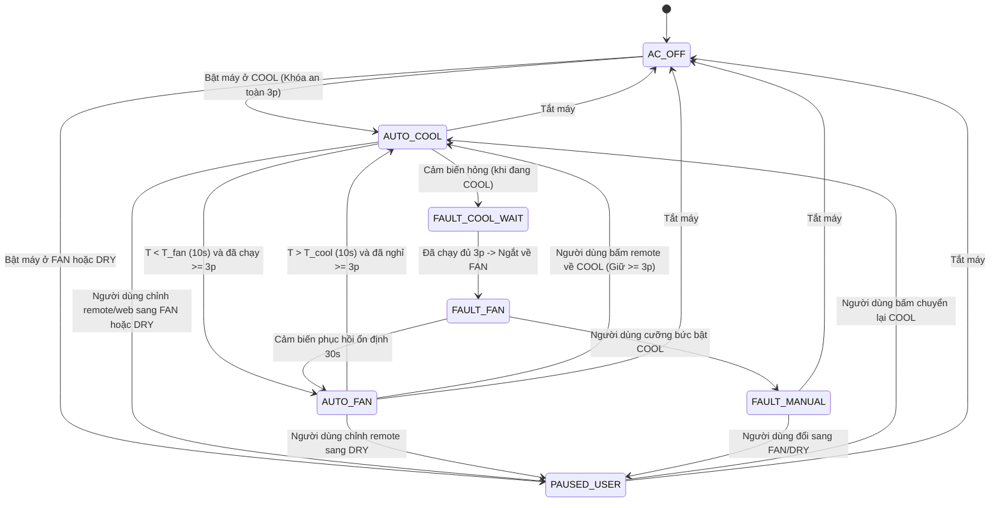

# MiAcLocal – Giải pháp điều khiển thông minh cho máy lạnh di động Xiaomi New WideTech Pro

Hệ thống điều khiển máy lạnh di động **Xiaomi New WideTech Pro** (mã model `nwt.airc.wap31a`, firmware `1.1.3`) sử dụng vi điều khiển **ESP32-S3** kết hợp cảm biến nhiệt độ độc lập **DS18B20**. Thiết bị giao tiếp trực tiếp qua mạng nội bộ (**local miIO protocol - UDP 54321**) mà không cần thông qua Cloud của Xiaomi hay ứng dụng Mi Home.

---

## 1. Bối cảnh & Vấn đề giải quyết

### 1.1. Đặc thù máy lạnh di động trong không gian nhỏ
Xiaomi New WideTech Pro là dòng **máy lạnh di động (Portable Air Conditioner)** nguyên khối, thường được người dùng lắp đặt trong các không gian nhỏ, phòng ngủ hẹp hoặc khu vực làm việc cục bộ:
- **Biến động nhiệt độ cực nhanh**: Do thể tích phòng nhỏ và lưu lượng gió máy nén di động mạnh, khi bật chế độ làm lạnh nhiệt độ phòng tụt xuống rất nhanh; ngược lại, khi ngắt làm lạnh, nhiệt độ cũng tăng trở lại trong thời gian ngắn.
- **Nguy cơ bật / tắt máy nén liên tục (Short-Cycling)**: Nếu sử dụng cơ chế điều nhiệt thông thường với khoảng trễ hẹp (1–2°C), máy nén sẽ bị đóng/ngắt liên tục nhiều lần chỉ trong một giờ. Việc khởi động máy nén quá dày đặc là nguyên nhân hàng đầu gây sụt áp, sục dầu máy nén, quá nhiệt cuộn dây và cháy hỏng block máy lạnh di động.

### 1.2. Vấn đề cảm biến tích hợp của máy
Bên cạnh đặc thù không gian nhỏ, máy còn gặp lỗi cảm biến nhiệt độ tích hợp trong thân máy:
- Do thiết kế nguyên khối của máy lạnh di động, cảm biến nằm sát dàn tản nhiệt và động cơ bên trong thân máy nên bị ảnh hưởng lớn bởi nhiệt độ nội bộ hoặc luồng gió quẩn, dẫn đến chỉ số sai lệch lớn so với nhiệt độ thực tế trong phòng.
- Máy nén (block làm lạnh) **chạy liên tục không ngắt** vì máy ngỡ phòng chưa đủ lạnh.
- Gây ra tình trạng phòng bị quá lạnh vào ban đêm, tạo cảm giác buốt khó chịu và tiêu tốn nhiều điện năng không cần thiết.

### 1.3. Giải pháp kỹ thuật
- **Đo nhiệt độ rời**: Dùng cảm biến số DS18B20 đặt tại vị trí trung tâm phòng để thu thập chính xác nhiệt độ môi trường thực tế, tách biệt hoàn toàn khỏi nhiệt phát tán của thân máy lạnh di động.
- **Chống bật/tắt dày đặc (Anti Short-Cycling)**: Kết hợp thuật toán trễ biên độ rộng (`Gap` tùy chỉnh 2.0 – 7.0°C, mặc định 4.0°C), bộ lọc xác nhận 10 giây và khóa cứng thời gian chạy/nghỉ tối thiểu 3 phút cho block.
- **Điều khiển local hoàn toàn**: ESP32 gửi lệnh qua giao thức miIO mã hóa AES trong mạng WiFi nội bộ (độ trễ < 50ms), vận hành ổn định không phụ thuộc mạng Internet.
- **Cơ chế ngắt/đóng block thông minh**: Do thiết bị không mở API can thiệp rơ-le block trực tiếp, giải pháp chuyển đổi qua lại giữa hai chế độ:
  - **`COOL`**: Block chạy làm lạnh.
  - **`FAN`**: Block ngắt, quạt vẫn thổi gió đối lưu phòng.

---

## 2. Kiến trúc hệ thống

```mermaid
flowchart LR
    subgraph Room["Không gian phòng"]
        Remote["Remote hồng ngoại (IR)"] -->|Điều khiển vật lý| AC["Máy lạnh Xiaomi WideTech Pro"]
        Sensor["Cảm biến DS18B20"] -->|1-Wire (GPIO21)| ESP["Bộ điều khiển ESP32-S3"]
    end

    subgraph LocalNetwork["Mạng nội bộ (LAN / WiFi)"]
        ESP <-->|"miIO UDP:54321 (AES-128-CBC)"| AC
        Browser["Điện thoại / Máy tính"] <-->|"HTTP :80 (Web UI)"| ESP
    end

    subgraph CloudAnalytics["Hệ sinh thái phân tích (Tùy chọn)"]
        ESP -.->|"HTTPS /v2/pipeline"| Turso[("Turso Cloud SQLite")]
        Turso -.-> Stats["MiAcStats Dashboard (Go)"]
    end
```

---

## 3. Thành phần sử dụng (Hardware & Software)

### 3.1. Phần cứng (Hardware)
| Linh kiện | Chân kết nối | Vai trò |
|---|---|---|
| **ESP32-S3** (hoặc ESP32 tiêu chuẩn) | – | Vi điều khiển trung tâm, chạy máy trạng thái non-blocking, web server và socket UDP |
| **DS18B20** | `GPIO21` | Cảm biến nhiệt độ số 1-Wire (độ phân giải 12-bit, chu kỳ đọc ~1s, trở kéo lên 4.7 kΩ) |
| **Nút BOOT** | `GPIO0` | Nhấn giữ 5 giây khi cần xóa thông tin WiFi để đưa về chế độ cấu hình SoftAP |

### 3.2. Phần mềm & Giao thức (Software & Protocol)
- **Giao thức miIO (Local UDP 54321)**:
  - Header chuẩn 32-byte định dạng miIO (`0x2131`), quản lý Device ID và Timestamp trôi dạt.
  - Mã hóa payload JSON bằng **AES-128-CBC** với `key = MD5(token)` và `iv = MD5(key + token)`.
  - Tích hợp sẵn qua các thư viện lõi ESP32 (`MD5Builder`, `mbedtls/aes.h`), không phụ thuộc thư viện ngoài nặng nề.
- **Định dạng lệnh MIoT (JSON-RPC)**:
  - Giao tiếp qua hai phương thức: `get_properties` (đọc trạng thái) và `set_properties` (ra lệnh điều khiển).
  - Chu kỳ đọc định kỳ (poll): **3 giây / lần**.
- **Web UI & NVS**:
  - Web Server nhúng cổng 80, giao diện tối ưu nhẹ cho thiết bị di động, tự động cập nhật trạng thái mỗi 2 giây.
  - Lưu trữ cài đặt (`Target`, `Gap`, `Auto ON/OFF`, WiFi) vào bộ nhớ Flash NVS bền vững.

---

## 4. Chi tiết giải pháp điều khiển (Core Control Strategy)

Phần điều khiển là trái tim của dự án, được thiết kế với cơ chế trễ kép, bảo vệ máy nén toàn diện và đồng bộ mượt mà với remote vật lý.

### 4.1. Cơ chế đóng / ngắt block máy nén (COOL ↔ FAN)
Máy lạnh không cho phép can thiệp trực tiếp phần cứng máy nén qua phần mềm. Hệ thống điều tiết hoạt động của máy nén gián tiếp thông qua chuyển chế độ:
- **Đóng block (Bắt đầu làm lạnh)**: ESP32 gửi lệnh chuyển máy sang chế độ **`COOL`** (giá trị mode `0`).
- **Ngắt block (Dừng làm lạnh, giữ gió)**: ESP32 gửi lệnh chuyển máy sang chế độ **`FAN`** (giá trị mode `2`). Khi về FAN, block máy nén ngắt điện hoàn toàn, quạt gió vẫn tiếp tục quay nhẹ giúp không khí trong phòng không bị tù đọng.

### 4.2. Thuật toán trễ nhiệt độ (Hysteresis Loop) – Chống bật/tắt liên tục trong không gian nhỏ

Trong các không gian nhỏ, nhiệt độ phòng phản ứng cực kỳ nhạy cảm: khi máy lạnh thổi hơi lạnh, phòng giảm nhiệt nhanh chóng; nhưng khi vừa ngắt máy nén, nhiệt độ lại leo thang do diện tích hẹp và cách nhiệt kém. Để **triệt tiêu hoàn toàn tình trạng máy nén bị bật/tắt liên tục nhiều lần (short-cycling)**, hệ thống sử dụng thuật toán trễ với biên độ lớn có thể tùy chỉnh:

- **Target ($T_{target}$)**: Nhiệt độ cài đặt mong muốn (16 – 30 °C, đồng bộ với remote).
- **Gap ($\Delta T_{gap}$)**: Độ rộng khoảng trễ nhiệt độ (**2.0 – 7.0 °C**, bước 0.5 °C, mặc định **4.0 °C**).

Hai ngưỡng kích hoạt được tính toán như sau:
$$\text{Ngưỡng ngắt block (vào FAN): } T_{fan} = T_{target} - 1^\circ\text{C}$$
$$\text{Ngưỡng đóng block (vào COOL): } T_{cool} = T_{target} - 1^\circ\text{C} + \Delta T_{gap}$$

> [!TIP]
> **Tầm quan trọng của tham số Gap trong phòng hẹp:**
> - Nếu để trễ hẹp như máy lạnh thông thường (chỉ chênh 1°C), máy lạnh di động trong phòng nhỏ sẽ đóng/ngắt block liên tục sau mỗi 3–5 phút.
> - Bằng cách cho phép thiết lập `Gap = 3.5°C – 4.5°C` (ví dụ: Target 26°C thì dưới 25°C mới ngắt sang FAN và trên 29°C mới đóng lại COOL), hệ thống kéo dài chu kỳ làm lạnh sâu và chu kỳ nghỉ tự nhiên của phòng, giảm đáng kể số lần khởi động lại máy nén mỗi ngày.

#### Bộ lọc nhiễu nhiệt độ (10-second Threshold Filter)
Để tránh hiện tượng đóng/ngắt giả do dao động nhiệt tức thời (gió lạnh thổi lùa qua đầu cảm biến hoặc khi có người mở cửa phòng):
- Điều kiện vượt ngưỡng phải duy trì **liên tục ít nhất 10 giây**.
- Nếu nhiệt độ quay lại vùng an toàn dù chỉ 1 chu kỳ đọc, bộ đếm 10 giây sẽ reset về 0 và đếm lại từ đầu.

---

### 4.3. Các lớp bảo vệ máy nén (Compressor Protection)

Việc đóng ngắt block máy nén liên tục sẽ làm tụt áp ga, sục dầu bôi trơn và gây cháy máy nén di động. Hệ thống cài đặt các lớp bảo vệ nghiêm ngặt bằng thời gian:

| Cơ chế bảo vệ | Thời gian khóa | Nguyên lý hoạt động |
|---|---|---|
| **Thời gian chạy tối thiểu (Min Run Time)** | **3 phút** | Sau khi block bắt đầu chạy ở `COOL`, hệ thống khóa cứng không cho phép chuyển sang `FAN` trong ít nhất 3 phút, kể cả khi nhiệt độ phòng nhỏ hạ nhiệt rất nhanh xuống dưới ngưỡng ngắt. Điều này đảm bảo máy nén chạy đủ chu trình áp suất. |
| **Thời gian nghỉ tối thiểu (Min Rest Time)** | **3 phút** | Sau khi block ngắt (chuyển sang `FAN` hoặc tắt máy), hệ thống bắt buộc block nghỉ ít nhất 3 phút trước khi cho phép đóng lại `COOL`. Ngay cả khi phòng nhỏ nhanh nóng trở lại vượt ngưỡng $T_{cool}$, máy nén vẫn phải chờ đủ 3 phút để áp suất ga hồi về mức an toàn. |
| **Khóa an toàn khởi động (Startup Lock)** | **3 phút** | Khi ESP32 vừa khởi động hoặc máy lạnh vừa bật nguồn ở chế độ `COOL`, hệ thống mặc định coi như block vừa chạy và khóa 3 phút trước khi đánh giá nhiệt độ. |
| **Đồng hồ đếm ngược (Web Countdown)** | Thời gian thực | Web UI hiển thị chính xác số giây còn lại của khóa Min Run / Min Rest để người dùng dễ theo dõi. |

---

### 4.4. Xử lý sự cố cảm biến (Sensor Failsafe)
Khi cảm biến DS18B20 gặp sự cố (tuột dây, đứt cáp, nhiễu bus OneWire):
- **Nếu đang ở `COOL`**: Hệ thống không ngắt máy nén đột ngột mà chờ chạy đủ thời gian bảo vệ 3 phút (`FAULT_COOL_WAIT`), sau đó chuyển máy sang **`FAN`** (`FAULT_FAN`) để dừng làm lạnh an toàn, chống đóng băng dàn lạnh.
- **Nếu đang ở `FAN`**: Khóa vĩnh viễn, không cho phép tự động chuyển về `COOL`.
- **Tự động phục hồi**: Chỉ khi cảm biến trả về nhiệt độ hợp lệ liên tục trong **30 giây**, hệ thống mới chuyển lại trạng thái tự động bình thường.
- **Ưu tiên điều khiển thủ công**: Nếu cảm biến lỗi mà người dùng chủ động bấm remote sang `COOL`, hệ thống vào trạng thái `FAULT_MANUAL` và giữ nguyên chế độ người dùng đã chọn, không can thiệp.

---

### 4.5. Máy trạng thái (FSM) & Đồng bộ 2 chiều (Bidirectional Sync)

Hệ thống hoạt động theo máy trạng thái hữu hạn (FSM) phi chặn:



#### Phân biệt lệnh ESP32 và thao tác của người dùng
- **Tránh tự nhận nhầm lệnh của chính mình**: Khi ESP32 phát lệnh đổi chế độ (`set_properties`), nó gán cờ `pendingMode` và gia hạn 10 giây. Trong khoảng thời gian này, các phản hồi đọc về trùng với `pendingMode` sẽ được xác nhận là do ESP32 thực hiện, không xem là người dùng bấm remote.
- **Lọc bấm remote liên tục (Debounce 5 giây)**: Khi người dùng bấm remote lướt nhanh qua nhiều chế độ, ESP32 chỉ tiếp nhận chế độ mới sau khi nó đứng yên ổn định 5 giây.
- **Tôn trọng quyền điều khiển người dùng**: Nếu người dùng bấm remote chuyển sang `DRY` (hút ẩm) hoặc chủ động chọn `FAN`, hệ thống chuyển ngay sang `PAUSED_USER` và tạm ngừng chu trình tự động cho đến khi người dùng chọn lại `COOL`.
- **Duy trì cấp gió (Fan Level Preservation)**: Một số máy lạnh tự động reset cấp quạt về mặc định khi đổi chế độ. ESP32 lưu lại tốc độ gió hiện tại trước khi chuyển và gửi lệnh phục hồi nếu cấp gió bị thay đổi ngoài ý muốn.

---

## 5. Bảng ánh xạ MIoT (Đã kiểm chứng thực tế)

Các thuộc tính MIoT đã được quét và kiểm tra thực tế trên thiết bị `nwt.airc.wap31a` (firmware `1.1.3`):

| Thuộc tính | SIID | PIID | Kiểu dữ liệu | Giá trị thực tế | Ghi chú |
|---|---|---|---|---|---|
| **Nguồn (Power)** | 2 | 1 | Boolean | `false` = Tắt, `true` = Bật | Phản hồi tức thì |
| **Chế độ (Mode)** | 2 | 2 | Integer | **`0` = COOL, `1` = DRY, `2` = FAN** | Cốt lõi của giải pháp |
| **Nhiệt độ cài đặt (Target)** | 2 | 4 | Integer | `16` – `30` (°C) | Bước chỉnh 1°C |
| **Cấp quạt (Fan Level)** | 3 | 2 | Integer | **`0` = Thấp (Low), `1` = Cao (High)** | Chỉ có 2 mức |
| **Nhiệt độ máy đo** | 4 | 1 | Integer | Đơn vị °C | Chỉ dùng để tham khảo |
| **Chuông bíp (Buzzer)** | 5 | 1 | Boolean | `false` = Tắt, `true` = Bật | Hỗ trợ tắt tiếng khi auto |
| **Đèn LED màn hình** | 6 | 1 | Boolean | `false` = Tắt, `true` = Bật | Điều khiển qua Web |

---

## 6. Hướng dẫn cài đặt & Triển khai nhanh

### 6.1. Chuẩn bị thông tin thiết bị
1. Tìm địa chỉ IP nội bộ của máy lạnh Xiaomi trong danh sách cấp phát DHCP của router.
2. Lấy **Token miIO 32 ký tự** của máy lạnh (sử dụng công cụ `python-miio`, tiện ích `tools/miot_probe.py` hoặc ứng dụng Mi Home đã patch).

### 6.2. Cấu hình & Nạp firmware cho ESP32
1. Mở thư mục `MiAcLocal/`.
2. Sao chép file cấu hình mẫu:
   ```sh
   cp MiAcLocal/secrets.h.example MiAcLocal/secrets.h
   ```
3. Chỉnh sửa `MiAcLocal/secrets.h` với các thông số của mạng nhà bạn:
   ```cpp
   #define WIFI_STA_SSID       "Ten_WiFi_Nha_Ban"
   #define WIFI_STA_PASS       "Mat_Khau_WiFi"
   #define DEFAULT_STATIC_IP   "192.168.1.50"      // IP tĩnh cho ESP32
   #define DEFAULT_AC_IP       "192.168.1.100"     // IP của máy lạnh
   #define DEFAULT_AC_TOKEN    "abcdef0123456789abcdef0123456789" // 32 ký tự hex
   ```
4. Nạp sketch vào ESP32-S3 bằng Arduino IDE (chọn board `ESP32S3 Dev Module`, Flash Size 4MB/8MB, baudrate nạp 921600).

### 6.3. Sử dụng & Tinh chỉnh qua Web UI
- Mở trình duyệt và truy cập vào IP tĩnh đã cấu hình cho ESP32 (ví dụ: `http://192.168.1.50`).
- Giao diện cung cấp các nút:
  - Bật / Tắt máy lạnh, chuyển đổi các chế độ COOL, DRY, FAN.
  - Tăng / Giảm nhiệt độ mục tiêu (`Target`) và khoảng trễ (`Gap`).
  - Nút chuyển nhanh chế độ **Tự động (Auto Mode)**.
  - Đồng hồ đếm ngược bảo vệ máy nén (Min Run / Min Rest).
  - Nhật ký sự kiện (Event Log) phục vụ theo dõi và chẩn đoán lỗi.

---

## 7. Module phụ trợ: MiAcStats (Dashboard & Ước tính tiền điện)

Trong thư mục `MiAcStats/` có sẵn một dịch vụ dashboard viết bằng **Go (Golang)**:
- **Cơ chế Sleep-by-default**: ESP32 gửi thống kê tóm tắt mỗi phút trực tiếp lên cơ sở dữ liệu đám mây **Turso SQLite** qua HTTPS API mà không cần container Go phải chạy 24/7.
- **Rollup dữ liệu**: Tự động gộp các bucket 1 phút cũ hơn $N$ ngày thành các bản ghi theo giờ (Hourly Rollup), giảm 60 lần dung lượng lưu trữ.
- **Tính toán điện năng**: Thống kê số giờ chạy block làm lạnh (`COOL`), giờ chạy quạt gió (`FAN`), ước tính chỉ số kWh và tính toán tiền điện theo biểu giá lũy tiến 6 bậc của EVN.
- Khởi chạy nhanh bằng Docker:
  ```sh
  cd MiAcStats
  cp .env.example .env
  docker compose up -d
  ```

---

## Giấy phép (License)
Dự án được phát hành dưới giấy phép MIT License. Tự do sử dụng, chỉnh sửa và triển khai cho mục đích cá nhân.
